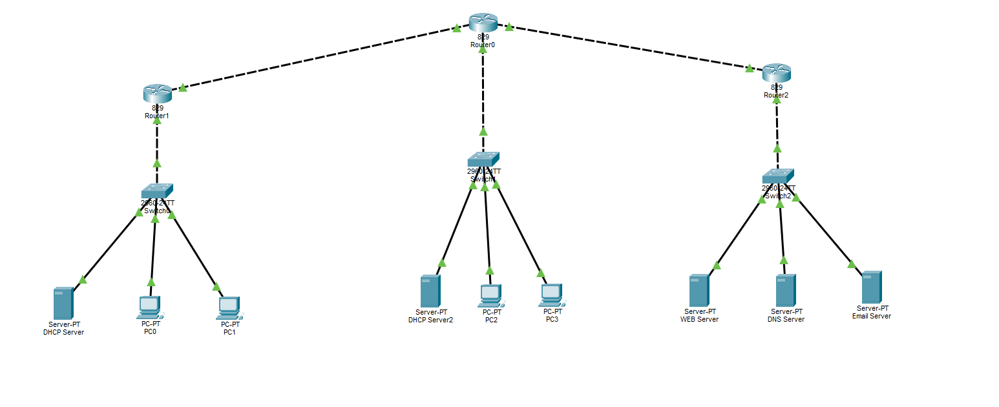

# Multi-LAN Enterprise Network Simulation (Cisco Packet Tracer)


A complete enterprise campus network design and simulation built in **Cisco Packet Tracer** for **SE312: Data Communication and Networks** at the **University of Business and Technology (UBT)**. 

This project interconnects **three separate Star-topology Local Area Networks (LANs)** across a backbone of **three Cisco 829 routers**, enabling automated host IP assignment via DHCP, cross-subnet static routing, DNS domain name resolution, HTTP web hosting, and SMTP/POP3 email communication under the `ubt.edu.sa` domain.

---

## Network Topology



> *Note: Upload your topology screenshot to the repository as `topology.png` to display it above.*

### Architecture Overview
The network follows a **Hybrid / Tree Topology** divided into **5 distinct IPv4 `/24` subnets**:
1. **LAN 1 (`192.168.1.0/24` — User Department A):** Managed by `Switch0` and routed by `Router1`. Hosts `PC0`, `PC1`, and a dedicated local `DHCP Server`.
2. **LAN 2 (`192.168.2.0/24` — User Department B):** Managed by `Switch1` and routed by `Router0`. Hosts `PC2`, `PC3`, and a dedicated local `DHCP Server2`.
3. **LAN 3 (`192.168.3.0/24` — Centralized Server Farm):** Managed by `Switch2` and routed by `Router2`. Hosts the static `WEB Server`, `DNS Server`, and `Email Server`.
4. **Backbone Link 1 (`10.0.1.0/24`):** Point-to-point routed link connecting `Router1` and `Router0`.
5. **Backbone Link 2 (`10.0.2.0/24`):** Point-to-point routed link connecting `Router0` and `Router2`.

---

## Hardware & Cabling Inventory

| Device Category | Model | Quantity | Device Names | Cabling Used |
| :--- | :--- | :---: | :--- | :--- |
| **Routers** | Cisco `829` | 3 | `Router1`, `Router0`, `Router2` | Copper Cross-Over (Router-to-Router & Router-to-Switch) |
| **Switches** | Cisco `2960-24TT` | 3 | `Switch0`, `Switch1`, `Switch2` | Copper Cross-Over (Uplink) / Straight-Through (Hosts) |
| **Servers** | `Server-PT` | 5 | `DHCP Server`, `DHCP Server2`, `WEB Server`, `DNS Server`, `Email Server` | Copper Straight-Through |
| **Workstations** | `PC-PT` | 4 | `PC0`, `PC1`, `PC2`, `PC3` | Copper Straight-Through |

---

## IPv4 Addressing Table

All subnets use a Class C `/24` subnet mask (`255.255.255.0`). Because the Cisco `829` router's physical GigabitEthernet interfaces operate as built-in switchports, each physical port is mapped to an isolated access VLAN and routed via Switched Virtual Interfaces (SVIs).

| Device Name | Role / LAN | Physical Port | Interface / Mode | IPv4 Address | Subnet Mask | Default Gateway | DNS Server |
| :--- | :--- | :--- | :--- | :--- | :--- | :--- | :--- |
| **`Router1`** | LAN 1 Gateway | `GigabitEthernet1` | `Vlan10` (Static) | `192.168.1.1` | `255.255.255.0` | N/A | N/A |
| **`Router1`** | Link to `Router0` | `GigabitEthernet2` | `Vlan101` (Static) | `10.0.1.1` | `255.255.255.0` | N/A | N/A |
| **`Router0`** | Link to `Router1` | `GigabitEthernet1` | `Vlan101` (Static) | `10.0.1.2` | `255.255.255.0` | N/A | N/A |
| **`Router0`** | LAN 2 Gateway | `GigabitEthernet2` | `Vlan20` (Static) | `192.168.2.1` | `255.255.255.0` | N/A | N/A |
| **`Router0`** | Link to `Router2` | `GigabitEthernet3` | `Vlan102` (Static) | `10.0.2.1` | `255.255.255.0` | N/A | N/A |
| **`Router2`** | LAN 3 Gateway | `GigabitEthernet1` | `Vlan30` (Static) | `192.168.3.1` | `255.255.255.0` | N/A | N/A |
| **`Router2`** | Link to `Router0` | `GigabitEthernet2` | `Vlan102` (Static) | `10.0.2.2` | `255.255.255.0` | N/A | N/A |
| **`DHCP Server`** | LAN 1 DHCP | `FastEthernet0` | Static | `192.168.1.2` | `255.255.255.0` | `192.168.1.1` | `192.168.3.3` |
| **`PC0`** | LAN 1 Client | `FastEthernet0` | DHCP | `192.168.1.10` | `255.255.255.0` | `192.168.1.1` | `192.168.3.3` |
| **`PC1`** | LAN 1 Client | `FastEthernet0` | DHCP | `192.168.1.11` | `255.255.255.0` | `192.168.1.1` | `192.168.3.3` |
| **`DHCP Server2`**| LAN 2 DHCP | `FastEthernet0` | Static | `192.168.2.2` | `255.255.255.0` | `192.168.2.1` | `192.168.3.3` |
| **`PC2`** | LAN 2 Client | `FastEthernet0` | DHCP | `192.168.2.10` | `255.255.255.0` | `192.168.2.1` | `192.168.3.3` |
| **`PC3`** | LAN 2 Client | `FastEthernet0` | DHCP | `192.168.2.11` | `255.255.255.0` | `192.168.2.1` | `192.168.3.3` |
| **`WEB Server`** | HTTP Server | `FastEthernet0` | Static | `192.168.3.2` | `255.255.255.0` | `192.168.3.1` | `192.168.3.3` |
| **`DNS Server`** | DNS Resolver | `FastEthernet0` | Static | `192.168.3.3` | `255.255.255.0` | `192.168.3.1` | `192.168.3.3` |
| **`Email Server`**| SMTP / POP3 | `FastEthernet0` | Static | `192.168.3.4` | `255.255.255.0` | `192.168.3.1` | `192.168.3.3` |

---

## Configured Services & Protocols

* **Static Routing (`Layer 3`):** Configured manual `ip route` entries across `Router1`, `Router0`, and `Router2` so every router maintains full reachability to all remote LANs and backbone links.
* **Dynamic Host Configuration Protocol (`DHCP`):** Two isolated DHCP pools (`192.168.1.10+` in LAN 1 and `192.168.2.10+` in LAN 2) dynamically lease IPv4 addresses, subnet masks, default gateways, and the centralized DNS server IP (`192.168.3.3`) to client PCs.
* **Domain Name System (`DNS`):** Configured `A Records` on `DNS Server` (`192.168.3.3`):
  * `www.ubt.edu.sa` $\rightarrow$ `192.168.3.2` (`WEB Server`)
  * `ubt.edu.sa` $\rightarrow$ `192.168.3.4` (`Email Server`)
* **Web Server (`HTTP / HTTPS`):** Hosts the campus web page accessible from any workstation via `http://www.ubt.edu.sa`.
* **Email Server (`SMTP / POP3`):** Configured with domain `ubt.edu.sa` and user mailboxes (`pc0@ubt.edu.sa`, `pc1@ubt.edu.sa`, `pc2@ubt.edu.sa`, `pc3@ubt.edu.sa` — password: `1234`) supporting cross-network email delivery.

---

## How to Run & Verify

1. Download the `.pkt` file from this repository and open it in **Cisco Packet Tracer** (v8.0 or newer recommended).
2. Click **Fast Forward Time (`Alt + D`)** once or twice if any Spanning Tree port indicators are still amber until all link lights turn green.
3. **Verify End-to-End Connectivity (from `PC0` $\rightarrow$ `Desktop` $\rightarrow$ `Command Prompt`):**
   ```bash
   ipconfig /all              # Confirm DHCP lease (192.168.1.10) & DNS (192.168.3.3)
   ping 192.168.2.10          # Ping PC2 across Router1 -> Router0
   ping 192.168.3.2           # Ping WEB Server across Router1 -> Router0 -> Router2
   nslookup www.ubt.edu.sa    # Verify DNS resolution to 192.168.3.2
